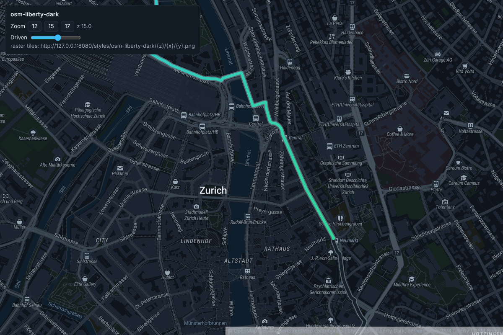
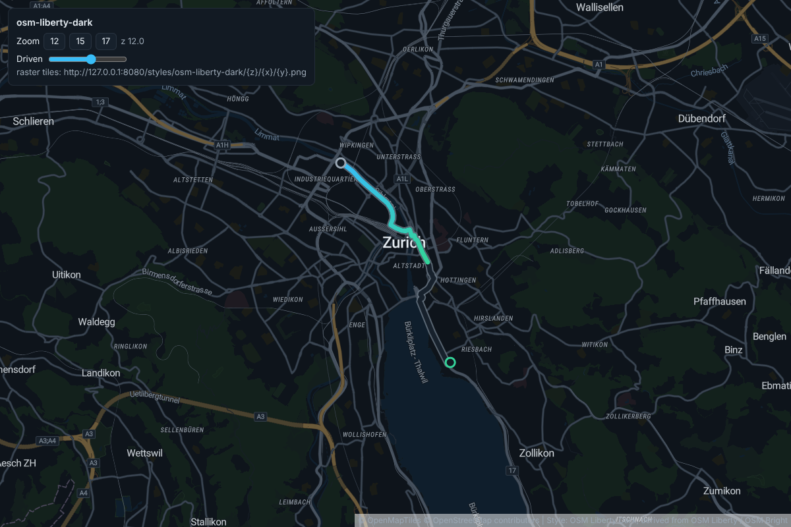
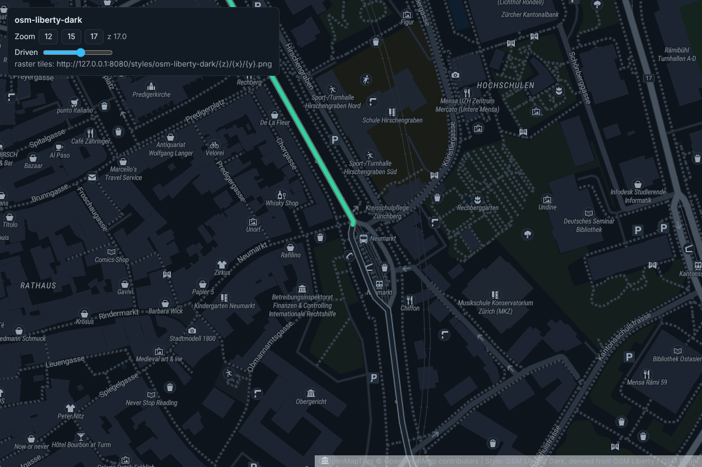

# OSM Liberty Dark [](LICENSE.md)

A dark variant of [OSM Liberty](https://github.com/maputnik/osm-liberty), made as a quiet
background for a route overlay in a dark web UI. Every layer, filter, zoom range and the layer
order are the same as in OSM Liberty, so it keeps the full level of detail. Only colors (paint
properties and icons) differ. See [CHANGELOG.md](CHANGELOG.md) for the colors per layer group
and the contrast figures against the route overlay.



**[Preview OSM Liberty Dark with Maputnik](https://maplibre.org/maputnik/?style=https://raw.githubusercontent.com/KIT-MRT/osm-liberty-dark/dark/style.json)**

## Usage

- Style: [`style.json`](style.json) (`"name": "osm-liberty-dark"`, OpenMapTiles schema 3.x,
  vector source `openmaptiles`)
- Sprites: `sprites/osm-liberty-dark` (`.json`, `.png`, `@2x.json`, `@2x.png`)
- Fonts: `Roboto Regular`, `Roboto Medium`, `Roboto Condensed Italic`, as in OSM Liberty
  (all part of [openmaptiles/fonts](https://github.com/openmaptiles/fonts) v2.0)

By default the vector tiles come from [OpenFreeMap](https://openfreemap.org/), the glyphs from
[Orange Mug](https://github.com/orangemug/font-glyphs) and the sprites from this branch on GitHub.
For self hosting (e.g. TileServer GL), point `sources.openmaptiles`, `sprite` and `glyphs` at your
own server. The `natural_earth_shaded_relief` raster source only affects zoom levels below 6,
so you can drop it together with the `natural_earth` layer.

## Preview with a route overlay

[`index.html`](index.html) shows the style with MapLibre GL JS and OpenFreeMap tiles, centered on
Karlsruhe at zoom 14. It draws a sample route the way the route selector UI does: a `#6b7885`
casing (11 px, 0.8 opacity), a `#17212c` track, the driven part as a `#38bdf8 → #34d399`
gradient (7 px), and start / goal markers. Serve the repository root and open the page:

```
python3 -m http.server 8000   # then open http://localhost:8000/
```

Query parameters:

- `?route=<url>`: a GeoJSON LineString / Feature / FeatureCollection to draw instead of the sample.
  The built-in Karlsruhe sample is hand-placed, so it only roughly follows the streets.
- `?driven=0..1`: the share of the route drawn as already driven (there is also a slider).
- `?raster=<xyz url>`: show server-rendered raster tiles instead of the vector style, e.g.
  `?raster=http://localhost:8080/styles/osm-liberty-dark/{z}/{x}/{y}.png`
  (add `&tileSize=512` for 512 px tiles).

The screenshots below were rendered with TileServer GL 5.6.0 (MapLibre GL Native) from the
OpenMapTiles demo extract of Zurich, with the route overlay of `index.html` on top:

| z12 | z15 | z17 |
|---|---|---|
|  |  |  |

## Data Sources

- [OpenMapTiles](http://openmaptiles.org/) as vector data source
- [Natural Earth Tiles](https://klokantech.github.io/naturalearthtiles/) for relief shading
- [Maki](https://www.mapbox.com/maki-icons/) as icon set
- [Orange Mug](https://github.com/orangemug/font-glyphs) as font glyphs

## Map Design

The map design originates from OSM Bright via OSM Liberty. The dark variant keeps every feature
of it and moves the colors to a low-chroma dark palette: neutral grays for roads that brighten
with the road class, a muted amber for motorways, and dark desaturated greens and blues for parks
and water. Nothing on the map is as bright or saturated as the overlay accents.

## Edit the Style

You can [edit the style directly online in Maputnik](https://maplibre.org/maputnik?style=https://raw.githubusercontent.com/KIT-MRT/osm-liberty-dark/dark/style.json).

This style actually triggered the need for the development of [Maputnik](https://github.com/maplibre/maputnik).

A pre-commit hook is included to validate and format the JSON styles using
[`maplibre-gl-style-spec`](https://www.npmjs.com/package/@maplibre/maplibre-gl-style-spec).
To use, just install the NPM dev dependencies:
```
npm install
```
and then validate or format the style with
```
npm run validate
npm run format
```

Validation and reformatting will happen automatically on commit if you have the
dependencies installed.

## Icon Design

A [Maki](https://github.com/mapbox/maki) icon set. OSM Liberty tells icon categories apart by
color. The dark variant draws every glyph in light gray instead, so the icons read on dark
ground and stay clear of the overlay accents.

Maki is a living project and adds new icons over time, which means that there
could be new icons that OSM Liberty could use for POIs. `sources_list.py` is a
simple script to list both the names in OSM Liberty's iconset that don't map to
any valid Maki name, and the Maki names that are not currently used in OSM
Liberty's iconset. You can run the script with `python3 sources_list.py`.

**Color Palette**

Color Name      | Hex Value | Used for
----------------|-----------|---------
Glyph           | `#9aa7b4` | all POI glyphs
Disc            | `#18212b` | round POI background
Ring            | `#2e3946` | ring around round POIs
Transport       | `#232e3b` | square transport icon background
Arrow           | `#66727f` | one-way arrow (set by hand in both `arrow.svg` files after a Maki Editor export)

**Modify Icons**

_On this branch the built sprites (`sprites/osm-liberty-dark*`) are committed; rebuild them after changing an SVG.<br>
The size 11 icons are included in the sprites for backward compatability. Please don't include new size 11 icons._

1. Take the `iconset.json` and import it to the [Maki Editor](https://www.mapbox.com/maki-icons/editor/).
2. Apply your changes and download the icons in SVG format and the iconset in JSON format.
Save the downloaded SVGs from Maki Editor to the folder [svgs_iconset](https://github.com/maputnik/osm-liberty/tree/gh-pages/svgs/svgs_iconset).
3. Mandatory if the updated `iconset.json` should become part of this repo: Format the JSON with `cat iconset.json | jq -MS '.'` for better legibility.
4. There are also SVGs in the folder [svgs_not_in_iconset](https://github.com/maputnik/osm-liberty/tree/gh-pages/svgs/svgs_not_in_iconset).
These are the SVGs for road shields, the dot used for city and town layers and the road area pattern which could not be modified using the Maki Editor. To modify these you could use e.g. [Inkscape](https://inkscape.org).
5. Generate the low and high resolution sprites: `npm run build_sprites`

## Have a look at ...

- [OSM Liberty](https://github.com/maputnik/osm-liberty) - the original light style this variant is based on
- [OSM Liberty Topo](https://github.com/nst-guide/osm-liberty-topo) - a topographic fork of OSM Liberty
